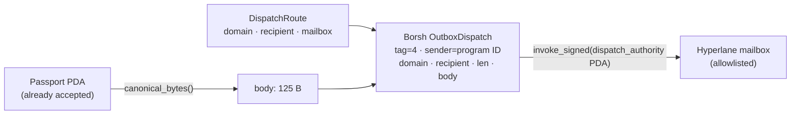

Protocols live on many chains. Hyperlane makes security state **portable**. The registry dispatches the canonical 125 bytes to destination chains, where a destination registry stores them and local consumers enforce against them.

<Accordion title="In plain terms" icon="lightbulb">
Hyperlane is a messaging system between blockchains. Halflife uses it to copy passport labels from Solana to other chains, such as Ethereum-compatible ones, so programs there can make the same go/stop decision.
</Accordion>

## The dispatch is a CPI, signed by a PDA

Hyperlane's Sealevel mailbox requires the dispatching program to sign with a **PDA derived from `[b"hyperlane_dispatcher", b"-", b"dispatch_authority"]` under the declared `sender`**. From the mailbox source:

> a program uses a dispatch authority PDA to sign the CPI on its behalf. Instruction processing logic prevents a program from specifying any message sender it wants by requiring the relevant dispatch authority to sign the CPI.

That's precisely why the destination's `originSender` check carries weight. **A program can't dispatch as a sender it doesn't control.** If an off-chain process dispatched instead, the sender would be that process, and the destination would be trusting it rather than the registry. The trust chain would break at its first link.

> Anyone may pay to relay a passport; nobody may invent what is relayed.

<Accordion title="In plain terms" icon="lightbulb">
When the Halflife program sends a message, Hyperlane requires a special signature that only that exact program can produce. So the receiving chain knows for certain the message came from the Halflife registry, not from someone pretending to be it. Anyone can pay the delivery fee, but nobody can change or invent what's being delivered.
</Accordion>

## What `dispatch` does



1. The passport is read **from the program's own account**, so a caller can't propagate a passport the registry never accepted.
2. The route's mailbox must equal the supplied `mailbox_program` (`MailboxMismatch`) **and** must be on the allowlist (`UnknownMailbox`), checked again at dispatch time and not only when the route was set.
3. The instruction data is Borsh-encoded by hand: variant tag `4` (`OutboxDispatch`), sender = program ID, `destination_domain` (u32 LE), `recipient` (32 bytes), body length (u32 LE), body. This avoids a dependency on the Hyperlane crates, which pin an incompatible `solana-program` major version.
4. CPI accounts: outbox PDA, dispatch authority (signer), system program, SPL Noop, payer, a fresh `unique_message` keypair, and the dispatched-message PDA.
5. Emits `PassportDispatched { circuit_hash, issuer, sequence, destination_domain }`.

### Allowlisted mailboxes

| Cluster | Mailbox |
|---|---|
| Solana devnet | `5yM5YrrzHCrp4ZPLKN9Y2eUAqEWsTbBqaorgbngQcR54` |
| Solana testnet | `75HBBLae3ddeneJVrZeyrDfv6vb7SMC3aCpBucSXS5aR` |
| Solana mainnet-beta | `E588QtVUvresuXq2KoNEwAmoifCzYGpRBdHByN9KQMbi` |

These are **two independent controls**: admin-gated routes, and an allowlist in code. A compromised admin key still can't aim the registry's signature at a program of its choosing.

## The chain of trust on a destination

```text
issuer signature  →  verified on Solana by the passport program
                  →  Solana consensus makes that state canonical
                  →  Hyperlane's ISM attests to what Solana said
                  →  destination registry
```

Hyperlane authenticates **transport**. It establishes that this is what the Solana registry says, not that the issuer's claim is independently true. Solana did that part. **A destination chain inherits Solana's verification.** It can't check ed25519 itself, because the EVM has no ed25519 precompile and doing it in Solidity costs more than the check is worth. Re-verifying ed25519 on the destination is the upgrade path, not a claim made today.

## What is real, and what isn't

<Tabs>
  <Tab title="Real (origin leg)">
    The registry's `dispatch` CPI'd into **Hyperlane's deployed devnet mailbox** and was accepted, with **the passport program as the sender**. Evidence is committed in `exercises/hyperlane-dispatch-*.json` and can be re-checked independently:

    ```bash
    ./target/release/halflife-exercise verify-dispatch exercises/hyperlane-dispatch-*.json
    ```

    This re-reads the message account **owned by Hyperlane's mailbox** (not by Halflife) and checks the transaction succeeded, the sender is the passport program, and the body is the recorded 125 bytes.

    | | |
    |---|---|
    | Origin | Solana devnet, Hyperlane domain `1399811151` |
    | Route | Domain `84532` (Base Sepolia) → **placeholder** recipient |
    | Registry admin | `Azh9zR13hCQiDYuSWZxJNmxarLzdr7uZrfohtUwMVPsh` |
  </Tab>
  <Tab title="Not demonstrated (destination leg)">
    **Delivery.** No destination registry is deployed on a public chain, and no relayer was paid. The route's recipient is an obviously synthetic placeholder (`0xeeee…eeee`).

    The destination contracts are exercised only against a **local chain and a stand-in mailbox** (`./scripts/cross-chain.sh`), which says so in its own output. See [Cross-chain demo](/guides/cross-chain-demo).
  </Tab>
</Tabs>

<Warning>
Don't describe Halflife as delivering passports cross-chain on public networks today. The origin leg is real. The destination leg is local (commitment **X3**).
</Warning>

## Why suppression needs no ISM countermeasure

A relayer can **censor** but can't **forge**. Withholding a Halflife message produces staleness, and staleness blocks. The ISM defends against forged state. Expiry defends against absent state. See [ISM configuration](/security/ism-configuration).
