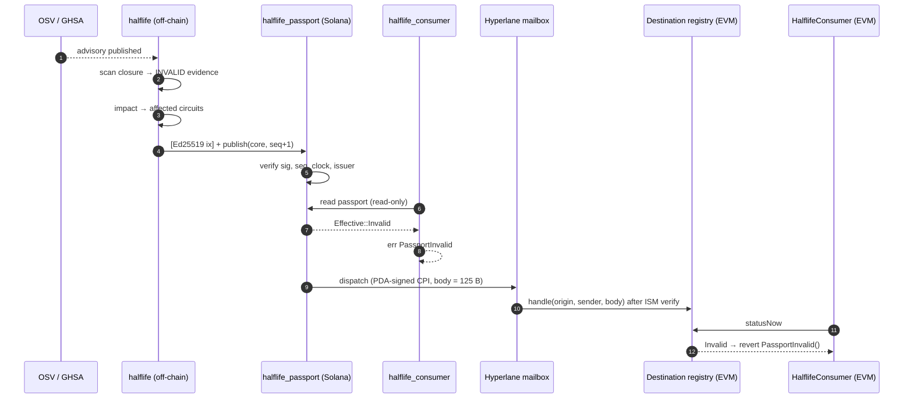
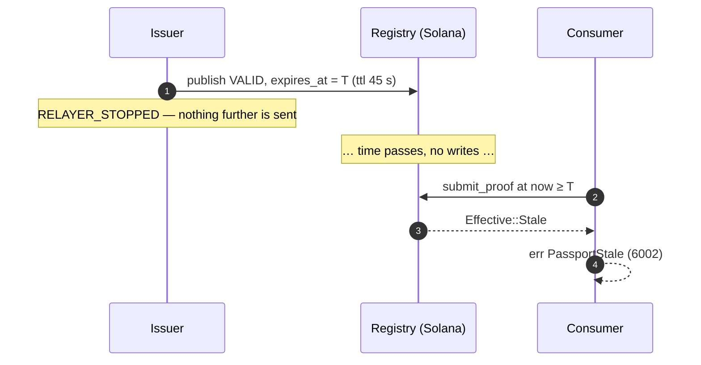

The MVP is a causal chain of ten steps. Steps 3 and 10 are the legibility layer. The rest are the mechanism.

| # | Step | Component |
|---|---|---|
| 1 | A real dependency/security event occurs | The outside world (OSV/GHSA) |
| 2 | Halflife identifies the affected circuits, unprompted | Lineage + registry |
| 3 | Projection shows the affected closure | `halflife impact` / control room |
| 4 | A signed passport changes state | Passport |
| 5 | Solana records the new canonical state | `halflife_passport::publish` |
| 6 | Hyperlane propagates it | `halflife_passport::dispatch` |
| 7 | A destination consumer blocks | `HalflifeConsumer` |
| 8 | The relayer is killed | Fire drill: relayer censorship |
| 9 | Expiry → `STALE` → block, with **no message delivered** | Any consumer |
| 10 | Projection on a healthy dependency returns nothing affected | `halflife impact …@0.5.0` |

<Note>
**Step 9 is the one most likely to be dropped and the one that matters most.** Steps 1–8 show the fast path. Step 9 shows the actual safety property. **Step 10 isn't decoration.** Without it the demo proves Halflife raises alarms. With it, the demo proves Halflife discriminates.
</Note>

<Accordion title="In plain terms" icon="lightbulb">
A security problem is announced. Halflife works out who's affected, writes a new "problem" label, puts it on Solana, and sends it to other chains, and programs there stop. Then comes the important test: cut the messenger off completely. The programs still stop once the old label expires. Finally, check a library version that's *fine*. Nobody is flagged, which shows the alarm isn't just going off at everything.
</Accordion>

## The fast path (dependency compromise)

Measured on devnet: **4 s** from invalidation to a blocked consumer (`exercises/dependency-compromise-*.json`).

## The slow path (relayer censorship)

Measured on devnet: **41 s** containment, with **exactly one on-chain write** (the baseline). `verify-all.sh` asserts that count. If a second write appeared, the block would have been caused by something published rather than by absence.

## Where each step is verified

| Step | Verified by |
|---|---|
| 2, 3, 10 | `verify-all.sh` §5–6: fleet registered, `0.4.0 → ≥3 affected`, `0.5.0 → 0 affected`, embargo hidden publicly |
| 4 | §4: scan vulnerable → `INVALID`, patched → `VALID`, signature and evidence bind, forged `VALID` rejected |
| 5 | §7: bench publishes and measures, replay refused (`SequenceNotIncreasing`) |
| 6 | §8c: `halflife-exercise verify-dispatch` re-reads the **Hyperlane-owned** message account on devnet |
| 7 | §8: `forge test`, §8c: `cross-chain.sh` drives an EVM consumer from devnet bytes |
| 8, 9 | §8b: censorship record verifies against devnet with exactly one write. §8: `test_blocksWhenNoUpdateEverArrives` |

<Warning>
**What isn't demonstrated:** delivery to a destination chain over a **public** network. No destination registry is deployed on a public chain, and no relayer was paid. The destination leg runs against a local chain with a stand-in mailbox. See [Hyperlane propagation](/architecture/hyperlane-propagation).
</Warning>
