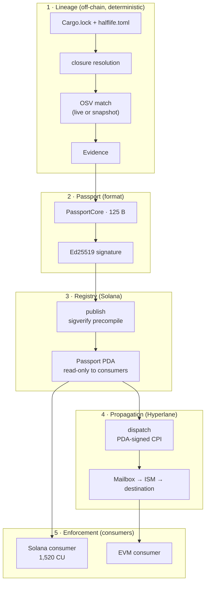

Halflife is five layers. Each has a single responsibility, and **the boundaries between them are the design**: each boundary is a trust boundary with a named commitment behind it.

| Layer | Job | Where it lives |
|---|---|---|
| **Lineage** | Resolve a circuit's dependency closure, and match every package against published advisories. No model in this path. Anyone can reproduce it offline. | `crates/halflife-lineage` |
| **Passport** | A 125-byte signed claim: which circuit, which issuer, what was verified, when it expires. Three independent implementations agree on every byte. | `crates/halflife-core`, `packages/passport-ts`, Solidity decoder |
| **Registry** | Published on Solana. Passport accounts are read-only in the consumer path, so any number of programs check the same passport in one slot without contending. | `solana/programs/halflife-passport` (plus a local SQLite registry for fleet intelligence: `crates/halflife-registry`) |
| **Propagation** | The registry dispatches state through Hyperlane, signing as itself. Hyperlane authenticates *transport*. It establishes what Solana said, not that the claim is true. | `dispatch` instruction, `evm/` |
| **Enforcement** | The consumer owns the policy. Halflife publishes state and never decides what a program requires. | `solana/programs/halflife-consumer`, `evm/src/HalflifeConsumer.sol` |

<Accordion title="In plain terms" icon="lightbulb">
1. **Lineage** works out which building blocks a project uses and whether any have known problems.
2. **Passport** turns that answer into a small signed label.
3. **Registry** stores the label on the Solana blockchain where anyone can read it.
4. **Propagation** copies the label to other blockchains.
5. **Enforcement** is the part inside each project's own program that reads the label and decides to continue or stop.

Each step trusts the others only for what they're responsible for, and nothing more.
</Accordion>

## The trust boundaries

| # | Boundary | Meaning |
|---|---|---|
| **B1** | Evidence ≠ Authority | The engine produces evidence. Issuers make claims. (`Evidence` / `SignedPassport` split) |
| **B2** | Authority ≠ Transport | Hyperlane authenticates transport. It never establishes that a claim is true. |
| **B3** | Transport ≠ Policy | The consumer owns policy. Halflife never sets it. |
| **B4** | Disclosure stays off the core | A core field would announce that an embargo exists. |

See [Trust boundaries](/security/trust-boundaries) for the full treatment.

## Components at a glance

<CardGroup cols={2}>
  <Card title="halflife CLI" icon="terminal" href="/reference/cli">keygen · scan · register · impact · registry · export · verify · vectors</Card>
  <Card title="halflife-exercise" icon="flame" href="/reference/exercise-cli">Fire drills, publishing, routing, and Hyperlane dispatch against devnet</Card>
  <Card title="halflife-bench" icon="gauge" href="/resources/measurements">Compute-unit benchmark and access-control attack tests in LiteSVM</Card>
  <Card title="halflife_passport" icon="box" href="/reference/solana-passport-program">Registry program: issuers, passports, routes, dispatch</Card>
  <Card title="halflife_consumer" icon="octagon-x" href="/reference/solana-consumer-program">Reference consumer that refuses to proceed</Card>
  <Card title="EVM destination" icon="hexagon" href="/reference/evm-contracts">Destination registry plus reference consumer, with a mandatory non-null ISM</Card>
  <Card title="Control room" icon="monitor" href="/architecture/control-room">React UI that renders CLI exports and reads devnet directly</Card>
  <Card title="GitHub Action" icon="git-pull-request" href="/reference/github-action">The advisory gate as a reusable composite action</Card>
</CardGroup>

## One serialization everywhere

The same 125 bytes are:

1. **signed** off-chain by the issuer (Rust `canonical_bytes`),
2. **verified** on Solana through the Ed25519 precompile, with no re-encoding,
3. **stored** in the passport PDA and **rebuilt** byte-for-byte (`Passport::canonical_bytes`, checked by the bench's "round trip preserves 125 bytes"),
4. **dispatched** as the Hyperlane message body,
5. **decoded** by the EVM destination (`_decode`), and
6. **decoded** in the browser (`LiveRead.tsx`).

There's no second format to keep in step. Conformance vectors pin it across Rust, Node, Solidity, and the browser. See [Conformance vectors](/reference/conformance-vectors).

<Accordion title="In plain terms" icon="lightbulb">
The label is written once in a fixed layout, and every system that touches it reads exactly that layout. Nothing translates it into another format along the way, so nothing can get lost or changed in translation.
</Accordion>

## Design rules that shape the code

| Rule | Consequence |
|---|---|
| **CLI before UI** (D5) | The control room renders `halflife export`. A capability not in the CLI isn't built. |
| **Measured, not simulated** (D7) | Every displayed timing comes from an observed on-chain event. |
| **Deterministic path stays model-free** (D3) | `--offline` plus a pinned OSV snapshot reproduces any scan. |
| **No manufactured scale** (D6) | The fleet is small and real: 8 systems, not 47. |
| **No tier without measurement** (D1) | C1 is hardcoded until C2+ recall is published. |
