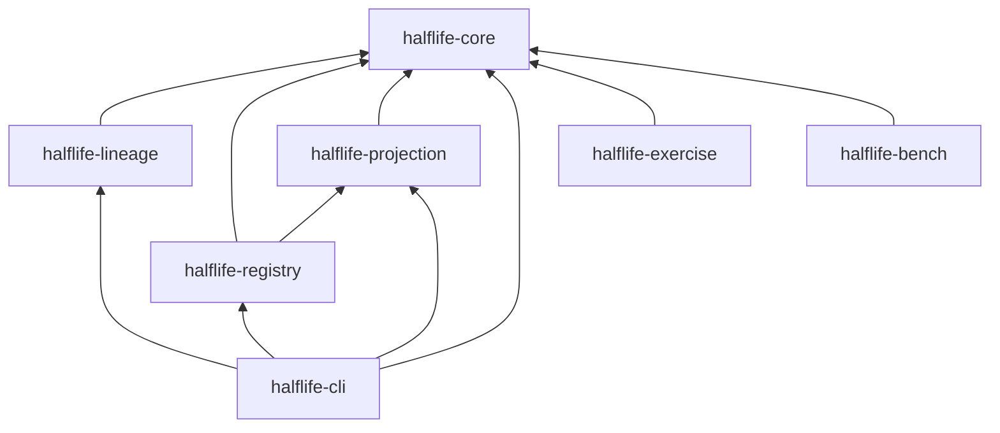

```text
halflife/
├── Cargo.toml                 # host workspace (7 crates), edition 2021, Apache-2.0
├── Cargo.lock
├── halflife.toml              # Halflife's own subject, for its self-passport
├── action.yml                 # reusable GitHub Action (advisory gate)
├── README.md · SECURITY.md · LICENSE
│
├── crates/
│   ├── halflife-core/         # passport primitive: PassportCore, Evidence, decide()
│   ├── halflife-lineage/      # Cargo.lock parsing + OSV advisory matching
│   ├── halflife-registry/     # SQLite fleet registry + reverse dependency index
│   ├── halflife-projection/   # pure impact projection over a RegistrySource port
│   ├── halflife-cli/          # the `halflife` binary (+ keys.rs, vectors.rs)
│   ├── halflife-bench/        # LiteSVM compute-unit benchmark + attack tests
│   └── halflife-exercise/     # `halflife-exercise`: fire drills, publish, dispatch
│
├── solana/                    # SEPARATE Cargo workspace (SBF toolchain 1.84)
│   ├── Anchor.toml
│   └── programs/
│       ├── halflife-passport/ # registry: issuers, passports, config, routes, dispatch
│       └── halflife-consumer/ # reference consumer that refuses to proceed
│
├── evm/                       # Foundry project
│   ├── src/                   # DestinationRegistry, Consumer, MockMailbox, interfaces
│   └── test/                  # Destination.t.sol, Ism.t.sol, Conformance.t.sol
│
├── packages/
│   └── passport-ts/verify-vectors.mjs   # independent zero-dependency Node implementation
│
├── apps/
│   └── control-room/          # React 18 + Vite 6 UI (deployed on Vercel)
│
├── fixtures/
│   ├── orchard-vulnerable/    # halo2_gadgets 0.4.0 — real crates.io checksums
│   ├── orchard-patched/       # halo2_gadgets 0.5.0
│   ├── fleet/                 # six published crates' derived closures
│   ├── osv-snapshot.json      # pinned advisory snapshot for --offline
│   └── vectors.json           # conformance vectors (published test seed)
│
├── exercises/                 # recorded, re-verifiable fire drills + Hyperlane dispatch
├── scripts/                   # verify-all, demo, ci-gate, cross-chain, self-passport, …
└── docs/                      # source design documents (spec, policy, notes, plan)
```

<Accordion title="In plain terms" icon="lightbulb">
- **crates/** holds the main Rust code: the command-line tool and its building blocks.
- **solana/** holds the blockchain programs that run on Solana.
- **evm/** holds the contracts for Ethereum-style chains.
- **apps/** holds the website dashboard.
- **fixtures/** holds sample projects and saved data used for testing and demos.
- **exercises/** holds recordings of real emergency drills.
- **scripts/** holds one-command helpers.
- **docs/** holds the original design notes these pages are built from.
</Accordion>

## Host crates and their dependencies



`halflife-registry` depends on `halflife-projection` because it implements projection's `RegistrySource` port over SQLite.

| Crate | Key dependencies |
|---|---|
| `halflife-core` | `serde`, `serde_json`, `sha2`, `hex` |
| `halflife-lineage` | `toml`, `ureq` (OSV), `anyhow` |
| `halflife-registry` | `rusqlite` (bundled SQLite) |
| `halflife-cli` | `clap` 4 (derive), `ed25519-dalek` 2, `bs58`, `getrandom` |
| `halflife-bench` | `litesvm` 0.6, `solana-sdk` 2.2 |
| `halflife-exercise` | `solana-client` 2.2, `solana-sdk` 2.2, `ed25519-dalek`, `sha2` |

## Fixtures

| Fixture | Pins | Expected |
|---|---|---|
| `orchard-vulnerable` | `halo2_gadgets 0.4.0` | `INVALID` |
| `orchard-patched` | `halo2_gadgets 0.5.0` | `VALID` |
| `fleet/*` (6 systems) | Derived closures for published crates | Mixed. Four resolve to affected versions. |

The fleet's closures are **derived**: each published requirement is resolved to the highest release satisfying it, with optional dependencies included on the conservative reading. They aren't the crates' own lockfiles, and each fixture says so (limit **L7**). Every version and checksum is genuine crates.io data. Regenerate with `python3 scripts/build-fleet.py`.

<Note>
Four fleet members are subject to an **active disclosure notice period**. These docs don't name them. See [Disclosure status](/security/disclosure-status).
</Note>

## The `docs/` directory

| File | Content | Rendered here as |
|---|---|---|
| `passport-spec.md` | Frozen wire format v1.0.0 | [Wire format](/reference/passport-wire-format) |
| `capability-model.md` | C0–C5 ladder | [Capability ladder](/concepts/capability-ladder) |
| `commitments.md` | Every promise and its enforcement point | [Commitments](/security/commitments) |
| `disclosure-policy.md` | What is scanned and published | [Disclosure policy](/security/disclosure-policy) |
| `disclosure-status.md` | Live obligations | [Disclosure status](/security/disclosure-status) |
| `security-notes.md` | Self-review findings | [Self-review findings](/security/self-review-findings) |
| `self-passport.md` | Halflife under its own instrument | [Self-passport](/guides/self-passport) |
| `ism-config.md` | Destination ISM choice | [ISM configuration](/security/ism-configuration) |
| `deployments.md` | Addresses and reproduction | [Deployments](/resources/deployments) |
| `build-order.md` | Execution plan and gates | [Roadmap](/resources/roadmap) |
| `submission/` | Hackathon submission, business plan, scripts | [Product and business](/resources/product-and-business) |
