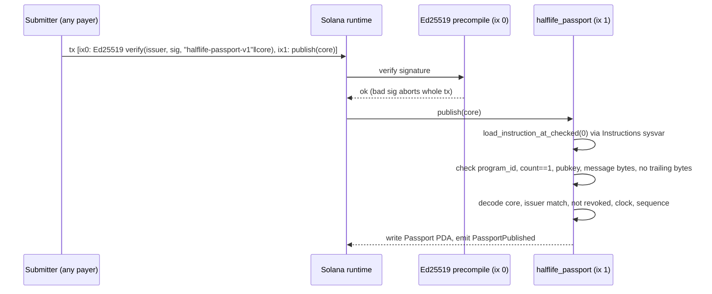

## Why Solana, concretely

Passport accounts are **read-only in the consumer path**. Sealevel, Solana's parallel runtime, serialises transactions only on **writable** accounts. So any number of programs can read the same passport in the same slot without contending. Only Halflife writes, and only when a status changes.

That's the access pattern Solana's account model exists to serve, and it's why an enforcement check can sit **inside** a hot path rather than beside it.

| Measurement | Compute units | Share of budget |
|---|---|---|
| Consumer passport check | **1,520 CU** | 0.76% of the 200,000 CU default transaction budget; 0.0015% of the 100M CU block limit |
| Publish a signed passport | 11,550 CU | |
| Register an issuer | 7,406 CU | |

The 1,520 figure **includes account deserialization and instruction dispatch**. It's taken from the runtime's own `consumed N of M compute units` log, not bracketed around the comparisons. Bracketing only the comparisons would give a smaller, flattering number nobody could reproduce in practice.

<Accordion title="In plain terms" icon="lightbulb">
On Solana, reading a shared record doesn't make anyone wait in line. Only *writing* does. Passport labels are written rarely and read constantly, so thousands of programs can check the same label at the same moment. The check costs less than 1% of what a normal transaction is allowed to spend, so it's cheap enough to run on every single action.
</Accordion>

## Signature verification without the issuer paying



By the time `publish` runs, the precompile has already checked the signature. A bad signature aborts the whole transaction. What remains is to confirm it covered **what we think it covered**. That's the step that's easy to get wrong and fatal to skip. `verify_ed25519` checks:

1. Instruction 0 exists and its program is `Ed25519SigVerify111111111111111111111111111`. Otherwise `MissingSignatureInstruction`.
2. **Exactly one signature** (`data[0] == 1`). Multiple would let an attacker append a valid signature over unrelated data and have the program inspect the wrong one. Otherwise `MalformedSignatureInstruction`.
3. The public key at offset 16 equals the expected issuer. Otherwise `SignerMismatch`.
4. The message at offset 112 equals the expected bytes. Otherwise `SignedMessageMismatch`.
5. **No trailing bytes** after the message, which would mean the signature covered more than was checked. Otherwise `SignedMessageMismatch`.

<Accordion title="In plain terms" icon="lightbulb">
Solana has a built-in, very cheap signature checker. The transaction asks it to check the issuer's signature first. The Halflife program then makes sure the checker was looking at *exactly* the right label, signed by *exactly* the right issuer, with nothing extra tacked on. Because of this, the issuer never has to hold any cryptocurrency. Anyone can deliver their signed label.
</Accordion>

## `publish` validation order

| # | Check | Error |
|---|---|---|
| 1 | `version == 1` | `UnsupportedVersion` |
| 2 | status byte ∈ {1, 2} | `UnknownStatus` |
| 3 | capability byte ≤ 5 | `UnknownCapability` |
| 4 | Issuer account key == core's issuer | `IssuerMismatch` |
| 5 | Issuer not revoked | `IssuerRevoked` |
| 6 | Ed25519 instruction covers `"halflife-passport-v1" ‖ core` by the issuer | see above |
| 7 | `issued_at ≤ now + 300` | `IssuedInFuture` |
| 8 | `expires_at > issued_at` | `ExpiryBeforeIssuance` |
| 9 | `issued_at ≥ issuer.registered_at` | `IssuedBeforeRegistration` |
| 10 | If the account exists: `sequence` strictly increases | `SequenceNotIncreasing` |
| 11 | If the account exists: same `circuit_hash` | `CircuitMismatch` |

## The reference consumer

```rust
#[derive(Accounts)]
pub struct SubmitProof<'info> {
    /// Read-only: no write lock, so concurrent consumers do not contend.
    pub passport: Account<'info, Passport>,
    pub caller: Signer<'info>,
}

#[inline(never)]
fn check(passport: &Passport, expected_circuit: &[u8; 32], min_capability: u8, now: i64) -> Result<()> {
    require!(passport.circuit_hash == *expected_circuit, ConsumerError::WrongCircuit);
    require!(passport.capability >= min_capability, ConsumerError::InsufficientCapability);
    match passport.effective(now) {
        Effective::Valid => Ok(()),
        Effective::Stale => err!(ConsumerError::PassportStale),
        Effective::Invalid => err!(ConsumerError::PassportInvalid),
    }
}
```

That's the whole enforcement decision: four comparisons and a clock read. Because `passport` is a required account, **there's no branch where a missing passport means proceed**. Anchor's account resolution fails first and the transaction aborts.

## Admin is narrow

`init_config` creates a `Config` whose `admin` controls **dispatch routes and nothing else**. The admin can't publish a passport, register an issuer, or change a status. Routes are admin-only, **and** the route's mailbox must be on a hard-coded allowlist of Hyperlane mailboxes. See [Hyperlane propagation](/architecture/hyperlane-propagation) and [Self-review findings](/security/self-review-findings).

## Deployed addresses (devnet)

| Program | Address |
|---|---|
| `halflife_passport` | [`CkDhRfJRiGEa3kgnEUEvCBgyht62MTkDD6e754DLtB2`](https://explorer.solana.com/address/CkDhRfJRiGEa3kgnEUEvCBgyht62MTkDD6e754DLtB2?cluster=devnet) |
| `halflife_consumer` | [`BAcrrJYj5Y5DfcqnHgDwm5rhJUJdowZh25NvFLJAUzSW`](https://explorer.solana.com/address/BAcrrJYj5Y5DfcqnHgDwm5rhJUJdowZh25NvFLJAUzSW?cluster=devnet) |
