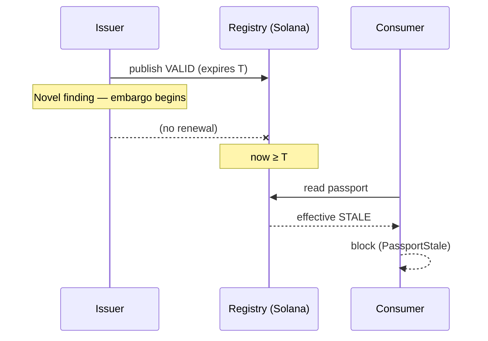

Halflife computes findings about software **other people maintain**. How those findings surface is governed by a [disclosure policy](/security/disclosure-policy) that existed before the first scan. This page explains the mechanism.

## Disclosure state lives on the evidence, never on the core

```rust
pub enum DisclosureState {
    Public,     // causal relationships may be shown
    Embargoed,  // projection must be computed from authorized evidence only
}

impl Default for DisclosureState {
    fn default() -> Self { DisclosureState::Embargoed }  // fail closed
}
```

- `disclosure` is a field of `Evidence`, **not** `PassportCore` (commitment **B4**). A core field would make every passport *announce* that something is embargoed, which is exactly the signal an embargo exists to suppress.
- **A missing field fails closed.** Evidence without an explicit disclosure state deserializes as `EMBARGOED` (test `missing_disclosure_state_defaults_to_embargoed`).
- The CLI default for `--disclosure` is `embargoed`. You opt **in** to publicity.

<Accordion title="In plain terms" icon="lightbulb">
Whether a finding can be talked about publicly is recorded in the detailed report, not on the public label. If the label itself said "secret finding here", it would give the secret away. When the report doesn't say either way, Halflife assumes "keep it quiet".
</Accordion>

## Audiences

| Audience | Sees | Where |
|---|---|---|
| `PUBLIC` | Only findings whose evidence is `PUBLIC` | Default for `impact`, the public `state.json` export, and the public control-room view |
| `OPERATOR` | Embargoed findings too | `impact --operator`, `export --operator`, `registry deps` |

Embargoed circuits are **absent, not redacted**. A public export simply doesn't contain them, and a dependency used only by embargoed circuits looks exactly like one nothing uses.

The registry also **withholds the evidence JSON** while a finding is embargoed (`evidence_json` is `NULL`). The passport row still carries everything a consumer needs. Only the causal detail is missing.

## Embargo via staleness

While a finding is embargoed, the affected passport is **not** published as `INVALID`, because an explicit invalidation names the problem by implication. Instead the issuer **stops renewing** it:



The passport expires, consumers resolve `STALE`, and they block, without any public statement about the cause.

<Accordion title="In plain terms" icon="lightbulb">
If a serious new problem is found that hasn't been made public yet, Halflife doesn't post "problem found", because that would tip off attackers. It just stops renewing the "OK" label. When the label runs out, systems stop by themselves, and nothing public explains why.
</Accordion>

## The limit, stated plainly

<Warning>
**Embargo via staleness is quieter than publishing `INVALID`. It isn't confidential.** (limits **L2**, **D8**)
</Warning>

Passports live on a public chain. If several circuits go stale together while others stay valid, an observer can correlate that directly from chain state. No interface decision prevents it, because the correlation is in the published data, not in the rendering.

Two partial mitigations exist, and neither makes it silent:

- **Randomised expiry windows** per circuit, so some fraction is always near expiry.
- **Staggered renewal cadence**, so benign staleness is ordinary rather than notable.

And there's a real tension (limit **L3**). Renewal must be cheap and automatic, or operators widen expiry windows and the fail-safe erodes. But reliable renewal makes staleness rare, and rare staleness is informative. The embargo mechanism needs staleness to be common enough to hide in.

<Accordion title="In plain terms" icon="lightbulb">
This trick reduces attention, but it doesn't keep secrets. Anyone watching the blockchain can see that several labels expired at once and guess that something is going on. The project says this openly instead of pretending the method is secret.
</Accordion>

## The policy timelines

| Finding type | What happens |
|---|---|
| Matches an **existing public advisory** (every C1 finding) | The vulnerability is public and citable. Halflife may publish that a registered system's closure matches it. |
| Names a **specific third party** | Notify maintainers first and wait **14 days**, even when the advisory is public, because *aggregation is itself a disclosure* |
| **Novel** (not yet published) | Coordinated disclosure: a private report, then **90 days** or until a fix ships (whichever is sooner), then publication |

No proof-of-concept exploit code is published for an unfixed vulnerability. See the [full policy](/security/disclosure-policy) and the [live status](/security/disclosure-status).
