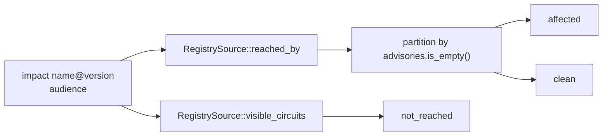

An advisory names the crates it affects and then says *"and any dependents thereof."* **Nothing enumerates the dependents.** Impact projection does, over the circuits registered in the Halflife registry.

```bash
halflife impact halo2_gadgets@0.4.0 --operator
```

```text
dependency  halo2_gadgets@0.4.0
audience    Operator

AFFECTED    3
  <circuit>               e8d694d442b6  GHSA-ww9q-8r59-xv46
  ...

blast radius  3 affected · 0 reached clean · 5 not reached
advisories    GHSA-ww9q-8r59-xv46
```

<Accordion title="In plain terms" icon="lightbulb">
You name a library version, and Halflife lists every registered project that uses it, split into "uses it and is affected", "uses it but nothing was found", and "doesn't use it at all". It's like a recall notice that tells you exactly which cars on the road contain the faulty part.
</Accordion>

## The partition

For a dependency `name@version` and an audience, projection returns:

| Bucket | Definition |
|---|---|
| **affected** | Visible circuits whose closure contains exactly `name@version` **and** has at least one advisory matched against it |
| **clean** | Visible circuits whose closure contains it with **no** advisory matched |
| **not_reached** | Visible circuits whose closure doesn't contain it |
| **advisories** | Every distinct advisory ID across the affected set, sorted and de-duplicated |

`not_reached = visible_circuits(audience) − (affected + clean)`.

## Discrimination: the step-10 property

<Note>
Anyone can build an alarm. Showing what a **healthy** dependency *doesn't* touch is what proves the tool discriminates.
</Note>

```bash
halflife impact halo2_gadgets@0.5.0 --operator   # AFFECTED none
```

Both 0.4.0 and 0.5.0 **reach** circuits. Only 0.4.0 **affects** them. This is step 10 of the [MVP causal chain](/architecture/lifecycle) and is pinned by the test `a_healthy_dependency_produces_no_false_impact`.

## How it's computed



- **Pure logic.** `halflife-projection` doesn't touch SQLite. The registry enters through the `RegistrySource` trait (a port), so the same code answers a CLI query, a CI check, and an export, and it's tested against an in-memory fake.
- **Reverse index.** In the registry, `idx_dependencies_reverse ON dependencies(name, version)` turns "what depends on `halo2_gadgets@0.4.0`?" from a full scan into a lookup.
- **CI-friendly.** `halflife impact` exits **2** whenever anything is affected, so it works as a gate without parsing stdout.

## Disclosure is a query parameter, not a filter

<Warning>
A public projection is computed **from authorized evidence only**. It's never built in full and then filtered.
</Warning>

Post-filtering leaks. The counts change, the response shape changes, and an observer learns that something was removed. Passing `Audience` **into** the source means withheld rows are never assembled.

The observable consequence is deliberate: **to a public caller, a dependency used only by embargoed circuits is indistinguishable from one nothing uses at all.**

| Test | What it pins |
|---|---|
| `embargoed_circuits_are_absent_from_a_public_projection` | Public sees only public circuits |
| `counts_do_not_reveal_withheld_circuits` | `not_reached` is computed against the **visible** total, so a caller can't subtract to count hidden circuits |
| `projection_of_an_embargoed_only_dependency_is_indistinguishable` | Same `affected`, `clean`, `not_reached`, `advisories` as an unused dependency |
| `the_dependency_index_does_not_leak_embargoed_names` | The dependency index can't reveal hidden circuit names (a real leak, fixed on 3 October 2026) |

<Accordion title="In plain terms" icon="lightbulb">
Some findings are kept quiet while the affected projects are given time to fix them. The public view doesn't show "3 hidden results". It shows nothing at all, exactly as if those projects didn't exist. Hiding things after building the full list would still give clues, such as odd totals. So the hidden items are never added in the first place.
</Accordion>

See [Disclosure and embargo](/concepts/disclosure-and-embargo).
