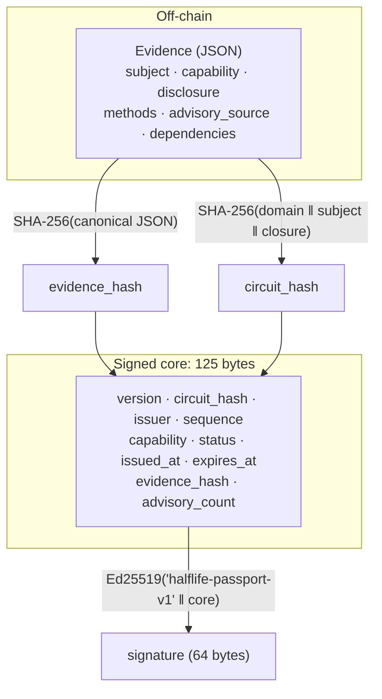

A **security passport** is a signed, machine-readable claim about **what was verified** on an exact circuit build. It isn't a claim that the circuit is safe, and no field in it should be read that way.

<Accordion title="In plain terms" icon="lightbulb">
A passport is a small signed label. It says "this specific version of this circuit was checked in this way, by this checker, at this time, and the check counts until this time." It never says "this is safe". It only says what was done.
</Accordion>

## Two artifacts, deliberately separated

| | On-chain core (`PassportCore`) | Off-chain evidence (`Evidence`) |
|---|---|---|
| Size | **125 bytes**, fixed | Unbounded |
| Content | Digests, status, clock, counters | Dependency closure, advisory hits, methodology, disclosure state |
| Consumer | Solana programs, in the hot path | Auditors, humans, CI |
| Binding | **Signed directly** (ed25519) | Bound via `evidence_hash` (SHA-256) |

A program never reads the dependency graph. It reads a fixed-width record and decides.



<Accordion title="In plain terms" icon="lightbulb">
There are two pieces. The **full report** lists every library and every problem found. It can be long, so it stays off the blockchain. The **short label** is always exactly 125 bytes and goes on the blockchain. The label contains a fingerprint of the full report, so anyone holding both can confirm they belong together. The label is signed, so nobody can change it without breaking the signature.
</Accordion>

## The core fields

| Field | Type | Meaning |
|---|---|---|
| `version` | `u8` | Wire format version. Currently `1`. |
| `circuit_hash` | `[u8; 32]` | Build-identity fingerprint of the circuit. See [Circuit identity](/concepts/circuit-identity). |
| `issuer` | `[u8; 32]` | Issuer's ed25519 public key, which is also a Solana pubkey. |
| `sequence` | `u64` | Monotonic per `(circuit_hash, issuer)`. See [Supersession and replay](/concepts/supersession-and-replay). |
| `capability` | `u8` (0–5) | Tier of verification **executed**. See [Capability ladder](/concepts/capability-ladder). |
| `status` | `u8` | `1` = `VALID`, `2` = `INVALID`. `STALE` is **not issuable**. |
| `issued_at` | `i64` | Unix seconds at issuance. |
| `expires_at` | `i64` | Unix seconds after which a `VALID` passport reads as `STALE`. |
| `evidence_hash` | `[u8; 32]` | SHA-256 over the canonical JSON of the evidence. |
| `advisory_count` | `u16` | Number of advisory hits. A cheap signal, **never a policy input**. |

The exact byte offsets are in the [wire format reference](/reference/passport-wire-format).

## The signed passport envelope

Off-chain, a passport travels as JSON:

```json passport.json
{
  "core": {
    "version": 1,
    "circuit_hash": "e8d694d4…4be34bca",
    "issuer": "1f0c…9a77",
    "sequence": "1",
    "capability": "C1",
    "status": "VALID",
    "issued_at": "1790859373",
    "expires_at": "1790945773",
    "evidence_hash": "7b1e…02cd",
    "advisory_count": 0
  },
  "issuer_id": "3Ffc…uQ8a",
  "signature": "<128 hex chars>"
}
```

- `sequence`, `issued_at`, and `expires_at` are JSON **strings**. A reader must **refuse** a JSON number for them (see [why](/reference/passport-wire-format#json-encoding-of-64-bit-fields)).
- `issuer_id` is the base58 form of `issuer`, for readability. A verifier **must reject** any passport where the two disagree. Otherwise a passport could advertise one issuer while being signed by another.

## How a passport is produced

<Steps>
  <Step title="Resolve">
    `halflife-lineage` reads `halflife.toml` (the subject) and `Cargo.lock` (the closure).
  </Step>
  <Step title="Match">
    Every registry package is matched against OSV, live or from a pinned snapshot.
  </Step>
  <Step title="Normalize">
    Dependencies are sorted by `(name, version)` and advisory lists are sorted and de-duplicated, so discovery order never affects a digest.
  </Step>
  <Step title="Derive">
    `status = INVALID` if any advisory matched, otherwise `VALID`. There's no model and no judgement involved.
  </Step>
  <Step title="Sign">
    `signature = Ed25519("halflife-passport-v1" ‖ canonical_bytes)`.
  </Step>
</Steps>

<Accordion title="In plain terms" icon="lightbulb">
Read the list of libraries, look each one up, tidy the list into a fixed order so the same project always produces the same fingerprint, decide "problem" or "no problem" by a simple rule, then sign the result.
</Accordion>

## Why ed25519

- Solana's **Ed25519 sigverify precompile** verifies it natively, so the exact bytes signed off-chain verify on-chain unchanged.
- An issuer identity is **just a Solana address**. `solana-keygen` produces a valid issuer key.
- Issuers **never need SOL** and never sign a Solana transaction. Anyone can submit a signed passport on their behalf, and the program verifies the issuer's signature.

## Related

<CardGroup cols={2}>
  <Card title="Status and staleness" icon="clock" href="/concepts/status-and-staleness">How a reader resolves VALID, STALE, and INVALID.</Card>
  <Card title="Wire format" icon="binary" href="/reference/passport-wire-format">Byte offsets and encoding rules.</Card>
</CardGroup>
