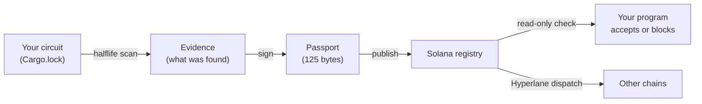

This page assumes no background. If you already know what a zero-knowledge proof, a dependency closure, and a Solana program are, you can skip to [The problem](/concepts/the-problem) or the [Architecture overview](/architecture/overview).

## The five ideas you need

<Steps>
  <Step title="Software is built from other software">
    Almost no project writes all of its own code. A Rust project lists the libraries it needs (called **crates**), each of those crates needs other crates, and so on. The full, exact list of every crate and version a build actually uses is its **dependency closure**. Rust records it in a file called `Cargo.lock`.
  </Step>
  <Step title="Some software proves things without revealing them">
    A **zero-knowledge (ZK) proof** lets someone prove a statement is true ("I have enough money for this payment", "this transaction follows the rules") without revealing the private details behind it. The rules a proof must satisfy are written as a **circuit**, a mathematical description of the statement.
  </Step>
  <Step title="Circuit bugs are silent">
    If a normal program has a bug, it often crashes or behaves visibly wrong. If a circuit has a bug (for example a missing constraint), it can accept a **valid-looking proof of a false statement**. Nothing crashes, nothing reverts, and nothing shows up in a block explorer. You can't see the damage.
  </Step>
  <Step title="Security checks go out of date">
    An audit tells you what experts could find *at the time*. As analysis tools improve, especially AI-assisted ones, bugs that were invisible become findable. The code doesn't change, but what's knowable about it does. So an "all clear" from years ago is weaker evidence today than it was then.
  </Step>
  <Step title="Blockchains can enforce rules automatically">
    A **smart contract** or **program** on a blockchain runs exactly as written. If it's told "don't accept proofs unless the safety label is current", it obeys every time, with no human in the loop.
  </Step>
</Steps>

## Putting them together

Halflife connects those ideas:

1. **It examines** a circuit's dependency closure and matches every crate against public vulnerability databases.
2. **It writes down the result** as a small, signed record called a **security passport**. The passport says which circuit, who checked it, what kind of check was done, whether a problem was found, and **when the record expires**.
3. **It publishes the passport on Solana**, where any program can read it cheaply.
4. **Programs check the passport** before accepting a proof. They stop if it's bad, expired, or missing.
5. **It can carry the passport to other blockchains** over Hyperlane, so a program on an Ethereum-style chain can make the same decision from the same bytes.

<Accordion title="In plain terms" icon="lightbulb">
Halflife is a smoke alarm combined with an automatic shut-off valve. It looks for known dangers in the parts your system is built from, writes a dated certificate, and connects that certificate to a valve. If the certificate says "danger" or runs out of date, the valve closes by itself.
</Accordion>

## The four possible states

Every circuit that a program cares about is in exactly one of four states at any moment.

| State | Colour | What it means | Does a program proceed? |
|---|---|---|---|
| `VALID` | Green | A trusted issuer checked this build and found nothing, and the check hasn't expired. | Yes |
| `STALE` | Amber | The check expired and nobody renewed it. **This is not a finding**: it means "no current evidence". | No |
| `INVALID` | Red | A trusted issuer reported a problem, such as a published advisory in the closure. | No |
| `NONE` / Missing | Grey | No passport exists at all. **Absence is not permission.** | No |

<Accordion title="In plain terms" icon="lightbulb">
Green means go. Every other colour means stop. Amber and red both stop, for different reasons. Red means "someone found a problem." Amber means "nobody has confirmed it's safe recently." Keeping those apart matters, because a delayed message isn't the same as a discovered vulnerability, and treating them the same would cause false panic.
</Accordion>

## Why it's designed this way

<AccordionGroup>
  <Accordion title="Why does silence cause a block instead of letting things continue?" icon="volume-x">
    If a passport stayed valid until someone explicitly said "stop", then anyone who could block that message (a malicious relayer, a network outage, a crashed server) could keep a broken system running. Halflife inverts this. Passports expire on their own, so blocking messages only makes systems **safer**. This is the central safety property of the whole project.
  </Accordion>
  <Accordion title="Why a small 125-byte record instead of the full report?" icon="minimize-2">
    On-chain programs pay for every byte and every instruction. The full evidence (every dependency, every advisory) can be large. So the large evidence stays off-chain, and a 32-byte fingerprint of it (`evidence_hash`) goes into the small passport. Programs read 125 bytes and decide. Auditors can fetch the full evidence and confirm it matches the fingerprint.
  </Accordion>
  <Accordion title="Why Solana?" icon="zap">
    On Solana, accounts that are only read (not written) can be read by many programs at once without waiting on each other. A passport is written rarely and read constantly, which is exactly that pattern. The measured cost of a check is 1,520 compute units, about 0.76% of a normal transaction budget. That's cheap enough to put the check *inside* the critical path.
  </Accordion>
  <Accordion title="Why Hyperlane?" icon="network">
    Protocols live on many chains. Hyperlane carries messages between chains, and its design forces a program to prove that it's the sender. So a destination chain can be sure the passport came from the Halflife registry and not from an impostor.
  </Accordion>
  <Accordion title="Why Zcash?" icon="target">
    Zcash's `halo2_gadgets` library had a real, published soundness bug (GHSA-ww9q-8r59-xv46). Halflife's test fixtures use genuine crates.io data on both sides of the fix, so every demonstration runs against a real vulnerability rather than a made-up one.
  </Accordion>
</AccordionGroup>

## What Halflife is not

<Warning>
- It is **not** a vulnerability discoverer. Today it matches dependencies against **already published** advisories (capability tier **C1**).
- It is **not** a guarantee that a circuit is safe. A `VALID` passport means "this check was run and found nothing", not "this is secure".
- It is **not** a central authority. Each consuming program decides its own policy, including which issuers it trusts and which capability tier it requires.
</Warning>

<Accordion title="In plain terms" icon="lightbulb">
Halflife doesn't hunt for brand-new bugs. It tells you whether your building blocks have **known** problems, and it makes sure that information is used automatically. It doesn't certify anything as "safe forever". It records honestly what was checked and when.
</Accordion>

## Where to go from here

<CardGroup cols={2}>
  <Card title="See who uses what" icon="users" href="/get-started/who-is-it-for">
    Find the part of Halflife that's relevant to your role.
  </Card>
  <Card title="Try it in the browser" icon="globe" href="/get-started/check-yours">
    Check any `Cargo.lock` with nothing to install.
  </Card>
  <Card title="Run it locally" icon="terminal" href="/get-started/quickstart">
    The developer quickstart.
  </Card>
  <Card title="Look up a term" icon="book-a" href="/resources/glossary">
    Every term in these docs, defined.
  </Card>
</CardGroup>
