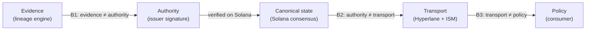

| # | Boundary | What it means | Enforced at |
|---|---|---|---|
| **B1** | Evidence ≠ Authority | The engine produces evidence. Only an issuer's signature makes a claim. | `Evidence` / `SignedPassport` split |
| **B2** | Authority ≠ Transport | Hyperlane authenticates *transport*. It never establishes that a claim is true. | The destination trusts `originSender` + ISM. Solana verified the issuer. |
| **B3** | Transport ≠ Policy | The consumer owns policy. Halflife never sets it. | `Policy` / consumer arguments / immutables |
| **B4** | Disclosure stays off the core | A core field would announce that an embargo exists | `Evidence.disclosure`, default `EMBARGOED` |

<Accordion title="In plain terms" icon="lightbulb">
Each party is trusted for one thing only. The scanner gathers facts but can't make claims. The issuer makes claims but can't decide what projects require. The messenger carries labels but can't vouch for them. Each project sets its own rules. No single party can do everything, so no single failure gives an attacker everything.
</Accordion>

## Who is trusted for what

| Party | Trusted for | Not trusted for |
|---|---|---|
| Lineage engine | Correctly resolving and matching | Making claims |
| OSV / GHSA | Advisory data (recorded as `advisory_source`) | Anything about circuits |
| Issuer | Its signed statement of what it executed | Safety; policy |
| Solana passport program | Verifying signatures, sequence, clock, lifecycle | Truth of the issuer's claim |
| Hyperlane (mailbox + ISM) | Authenticating that Solana said it | Truth of the claim; freshness |
| Relayer | Nothing. It can censor but can't forge. | Anything |
| Consumer | Its own policy | — |
| Control room | Displaying CLI output faithfully | Computing anything |

## The cross-chain chain of trust

```text
issuer signature  →  verified on Solana by the passport program
                  →  Solana consensus makes that state canonical
                  →  Hyperlane's ISM attests to what Solana said
                  →  destination registry
```

A destination chain **inherits Solana's verification**. That's a real dependency, not a detail.
